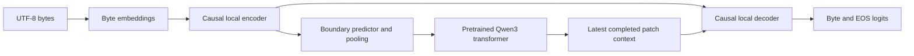

# BytePFT

*Retrofitting language models, one byte at a time.*

BytePFT is an experimental Python library for adapting pretrained Qwen3 language
models to operate on UTF-8 bytes. It learns a byte encoder, patch boundaries,
pooling interface, byte decoder and prediction head around an existing
transformer. Generation uses that byte head and does not call the original
subword tokenizer or source-model generation method.

**Version 0.1.0 provides a working, tested reference architecture.** It is not a
paper-faithful implementation, and full pretrained-model adaptation has not been
completed. A tiny model can be trained end to end on CPU. A real
`Qwen/Qwen3-0.6B-Base` checkpoint has passed a CPU gradient step and an exact
checkpoint round trip; this does not establish retained language-model quality.
See [STATUS.md](STATUS.md) and the [observed smoke result](docs/results/qwen_cpu_smoke.json).

## Install locally

Python 3.11+ is required. From this checkout:

```sh
uv sync
uv run bytepft --help
```

For the optional Hugging Face dataset loader:

```sh
uv sync --extra training
```

Alternatively, install the checkout with `python -m pip install -e .`.
The package is **not published to PyPI**. `pip install bytepft` is the intended
installation command after an explicit maintainer release.

CUDA, FlashAttention, Triton and specialized recurrent kernels are not needed to
import the library or run the reference CPU workflow. API and CLI defaults use
`device="cpu"`. `cuda`, `mps` and `auto` are explicit accelerator choices; neither
CUDA nor MPS execution has been validated for this release.

## Run the offline tiny example

This uses a randomly initialized small Qwen3 global transformer, not pretrained
Qwen weights. Stage 1 trains its byte interface while keeping the global weights
frozen.

```python
from bytepft import BytePFT, BytePFTConfig

converter = BytePFT.from_tiny(
    config=BytePFTConfig(
        hidden_size=32,
        encoder_layers=1,
        decoder_layers=1,
        bytes_per_patch=2,
    ),
    device="cpu",
    seed=42,
)
history = converter.retrofit(
    ["abcabcabc"] * 4,
    stage1_steps=60,
    stage2_steps=0,
    learning_rate=0.025,
    validation_fraction=0,
    output_dir="outputs/tiny",
)
converter.save_pretrained("outputs/tiny-saved")

model = BytePFT.load("outputs/tiny-saved", device="cpu")
print(model.generate("abc", max_new_bytes=24, temperature=0))
print(model.stats())
```

The generated string includes the prompt. Greedy decoding uses `temperature=0`.
A completed training loop enables generation; `quality_validated` remains false.
Calling `generate` before training completes raises `NotAdaptedError`.

The same workflow is available through the CLI:

```sh
uv run bytepft train-tiny --output outputs/tiny-cli --device cpu
uv run bytepft generate --model outputs/tiny-cli --prompt "hello" --max-new-bytes 32
```

The [complete tiny example](examples/train_tiny_model.py) writes a reproducible
JSON report; [its recorded CPU run](docs/results/tiny_cpu_example.json) contains
observed loss reduction and generated bytes. It uses
[configs/tiny_smoke.yaml](configs/tiny_smoke.yaml).

## Adapt a pretrained checkpoint

The adapter targets dense Hugging Face Qwen3 models. Prefer
`Qwen/Qwen3-0.6B-Base` for initial research: it is a pretrained base checkpoint.
`Qwen/Qwen3-0.6B` is its post-trained counterpart. Model configuration and source
identity are validated and recorded; other model families are unsupported.

```python
from bytepft import BytePFT

converter = BytePFT.from_pretrained(
    "Qwen/Qwen3-0.6B-Base",
    device="cpu",
    precision="fp32",
)
converter.configure(
    hidden_size=64,
    bytes_per_patch=4,
    encoder_layers=2,
    decoder_layers=2,
    boundary_mode="learned",
)
converter.retrofit(
    dataset="data/train.jsonl",
    stage1_steps=1000,
    stage2_steps=0,
    batch_size=2,
    learning_rate=1e-4,
    output_dir="outputs/qwen-byte",
)
```

This is an experimental adaptation recipe, **not an executed quality result or
a validated training budget**. It downloads source weights and uses the source
tokenizer during aligned Stage 1. Full adaptation on the pretrained checkpoint
has not been run. CPU execution is supported but may be slow; choose an
accelerator explicitly only when you intend to use it.

Stage 1 freezes the global transformer. The default for pretrained models is
`stage1_mode="aligned"`: oracle source boundaries, embedding alignment at `n=0`,
teacher patch context, observed patch-event distillation and byte CE. The tiny
default is `stage1_mode="diagnostic"`: supervised byte CE and fixed-target
boundary supervision.

Stage 2 runs only when `stage2_steps` is positive. It can update global and local
parameters with separate learning rates. Its reference boundary target is a
fixed-patch surrogate. See [training and resumption](docs/training.md) for typed
configuration, data, validation, checkpoints and the Stage 2 switch.

The [pretrained integration example](examples/retrofit_qwen.py) requires an
explicit device argument. Its [Qwen configuration](configs/qwen3_06b.yaml) is an
unvalidated bf16 accelerator recipe; select CPU/fp32 explicitly for a CPU
experiment. The separate [CPU smoke script](examples/qwen_cpu_smoke.py) downloads
the real weights, performs one gradient step and writes a large fp32 checkpoint;
it intentionally leaves generation disabled.

## Architecture



Ordinary bytes always use IDs `0..255`; PAD, BOS and EOS use `256`, `257` and
`258`. This is more than a tokenizer replacement: the trainable local modules
bridge byte sequences and the pretrained transformer's patch representation.
The reference encoder and decoder use GRUs. Fixed, causal learned and externally
supplied oracle patching support debugging and controlled experiments. Oracle
patching is unavailable for tokenizer-free generation.

Generation caches local recurrent state and the global KV cache. The global
transformer advances when a patch completes. An uncached implementation supports
correctness comparisons. See [tensor shapes and causal alignment](docs/architecture.md).

## Generate, evaluate and benchmark

```python
from bytepft import BytePFT
from bytepft.evaluation.benchmarks import benchmark_generation
from bytepft.evaluation.metrics import evaluate_model

model = BytePFT.load("outputs/tiny", device="cpu")
text = model.generate("abc", max_new_bytes=32, temperature=0.7, top_p=0.9, top_k=50)
raw = model.generate("abc", max_new_bytes=32, temperature=0, return_bytes=True)
details = model.generate("abc", max_new_bytes=32, temperature=0, return_details=True)
metrics = evaluate_model(model.model, ["abcabcabc"])
timings = benchmark_generation(model.model, "abc", max_new_bytes=32)
```

Text generation buffers incomplete UTF-8 suffixes and replaces malformed complete
sequences. `return_bytes=True` preserves all sampled bytes; detailed results
also expose the incomplete suffix. Sampling may emit invalid UTF-8 because the
byte head has no Unicode grammar constraint.

Evaluation reports negative log-likelihood per raw byte and bits per byte,
excluding document controls and padding. Benchmarks report observed prefill,
first-byte latency, generated bytes per second, global calls and tensor memory.
Peak GPU memory is reported only on CUDA. These measurements do not imply a
speedup over the source model; matched-device source comparisons and task-level
quality evaluations remain future experiments.

```sh
uv run bytepft inspect Qwen/Qwen3-0.6B-Base
uv run bytepft evaluate --model outputs/tiny --dataset data/validation.jsonl
uv run bytepft benchmark --model outputs/tiny --prompt "abc" --max-new-bytes 64
```

`inspect` loads configuration metadata, not model weights. Run each command with
`--help` for supported arguments.

## Validation, limits and roadmap

The CPU suite covers Unicode/raw-byte tokenization, patch coverage, causal
alignment, shapes and gradients, frozen/unfrozen stages, tiny-corpus loss
reduction, exact resumption, cached/reference inference and checkpoint corruption.
The actual 0.6B base-checkpoint smoke test verified finite local gradients,
unchanged frozen global parameters and a zero-difference logit round trip.
It deliberately leaves adaptation and quality status incomplete.

Remaining work includes full pretrained adaptation and task evaluation, exact
mLSTM local modules, one-byte-lookahead/fused boundary prediction, source suffix
embedding augmentation, first-class additional model adapters and accelerator
validation. Distributed training, optimized kernels and serving integrations are
outside this release. Source embeddings and output projection remain in saved
checkpoints for training compatibility, so this version does not claim their
memory savings.

This work is inspired by Benjamin Minixhofer and colleagues,
[*Retrofitting language models to operate over bytes*, Nature (2026)](https://www.nature.com/articles/s41586-026-11111-4).
The architecture and objectives were studied before implementation; deviations
and source-review details are documented in [research notes](docs/research.md).
No paper performance result is attributed to BytePFT.

Original code is Apache-2.0. See [LICENSE](LICENSE), [NOTICE](NOTICE),
[contributor instructions](CONTRIBUTING.md) and [CHANGELOG](CHANGELOG.md).
